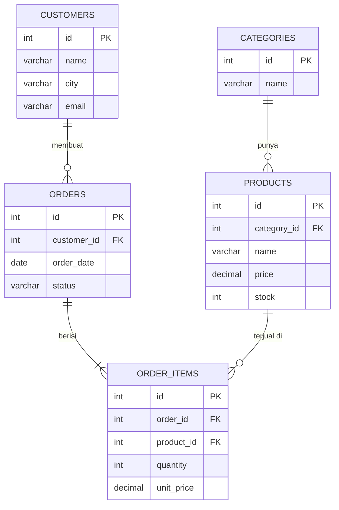

# SQL JOIN

### INNER · LEFT · RIGHT · FULL

Praktikum Workshop Basis Data · 2 pertemuan × 4 jam

<div class="pt-6 text-sm opacity-70">Studi kasus: Nusantara Mart 🛒</div>

<!--
CATATAN PEMAKAIAN
- Jalankan: npx slidev slides-sql-join.md  (disarankan Slidev versi terbaru)
- Slide padat memakai `zoom` pada frontmatter agar isi tidak terpotong.
  Jika terasa terlalu kecil/besar, ubah angka zoom (0.6 - 1.0) pada slide tersebut.
- Hasil query bisa ditampilkan bertahap dengan klik (v-click): mahasiswa menebak dulu, lalu hasil muncul.
-->

---
layout: default
zoom: 0.9
---

# Peta Waktu

<div class="grid grid-cols-2 gap-6 text-sm">
<div>

### Pertemuan 1 (4 jam)

| Sesi | Durasi | Materi |
|---|---|---|
| A | 30 mnt | Persiapan DB + konsep PK/FK |
| B | 60 mnt | `INNER JOIN` |
| C | 15 mnt | Istirahat |
| D | 60 mnt | `LEFT JOIN` |
| E | 30 mnt | `RIGHT JOIN` + rangkuman |
| F | 45 mnt | **Lembar Kerja 1** (20 soal) |

</div>
<div>

### Pertemuan 2 (4 jam)

| Sesi | Durasi | Materi |
|---|---|---|
| A | 15 mnt | Review |
| B | 45 mnt | `FULL JOIN` |
| C | 45 mnt | Anti-Join |
| D | 15 mnt | Istirahat |
| E | 45 mnt | `ON` vs `WHERE`, duplikasi, `NULL` |
| F | 30 mnt | JOIN + agregasi, VIEW, performa |
| G | 45 mnt | **Lembar Kerja 2** (20 soal) |

</div>
</div>

<div class="mt-4 text-sm">

**Pengayaan (opsional/mandiri, 45–60 mnt):** `SELF JOIN` dan `CROSS JOIN`

</div>

---
layout: default
zoom: 0.9
---

# Tujuan Pembelajaran

Setelah praktikum ini, kamu mampu:

1. Menjelaskan mengapa data dipisah ke beberapa tabel dan dihubungkan dengan **Primary Key** dan **Foreign Key**
2. Menulis `INNER`, `LEFT`, `RIGHT`, dan `FULL JOIN`, lalu **memilih yang tepat** untuk sebuah laporan
3. Menemukan data **tanpa pasangan** dengan teknik **anti-join**
4. Menghindari kesalahan umum: duplikasi baris, jebakan `ON` vs `WHERE`, masalah `NULL`
5. Menulis JOIN yang **bersih, aman, dan cepat** sesuai standar industri

<div class="mt-6 text-sm">

| Ikon | Arti | Ikon | Arti |
|---|---|---|---|
| 🧠 | Konsep | 💡 | Insight industri |
| ⌨️ | Praktik: ketik sendiri | ⚠️ | Awas, kesalahan umum |
| 🔮 | Prediksi dulu | ✅ | Cek hasil |

</div>

---
layout: default
zoom: 0.9
---

# Studi Kasus: Nusantara Mart 🛒

Kamu adalah **backend developer** toko online **Nusantara Mart**.

Tim bisnis meminta laporan seperti:

- "Daftar pesanan **beserta nama pelanggan**"
- "Pelanggan yang **belum pernah** belanja"
- "Produk yang **belum pernah terjual**"
- "**Omzet** per kategori"

Semua laporan ini butuh **JOIN**.

<div class="mt-4 p-3 rounded bg-blue-50 text-sm">

💡 **Konvensi industri:** nama tabel **jamak** + **snake_case** berbahasa Inggris (`order_items`), sama seperti Laravel, Rails, dan Django.

</div>

Database yang sama dipakai di **semua** latihan, sehingga hasil mudah dibandingkan.

---
layout: default
zoom: 0.8
---

# ERD Nusantara Mart



<div class="text-xs text-center">Satu kategori punya banyak produk · satu pelanggan punya banyak pesanan · satu pesanan punya banyak item</div>

---
layout: default
zoom: 0.8
---

# Struktur Tabel (1/2)

<div class="grid grid-cols-3 gap-4 text-xs">
<div>

**categories**

| Kolom | Tipe | Kunci |
|---|---|---|
| id | INT | PK |
| name | VARCHAR(50) | |

</div>
<div>

**customers**

| Kolom | Tipe | Kunci |
|---|---|---|
| id | INT | PK |
| name | VARCHAR(100) | |
| city | VARCHAR(50) | |
| email | VARCHAR(100) | UNIQUE |

</div>
<div>

**products**

| Kolom | Tipe | Kunci |
|---|---|---|
| id | INT | PK |
| category_id | INT NULL | FK → categories |
| name | VARCHAR(100) | |
| price | DECIMAL(12,2) | |
| stock | INT | |

</div>
</div>

<div class="mt-6 text-sm">

🧠 `products.category_id` boleh `NULL`, artinya produk **belum dikategorikan**.

</div>

---
layout: default
zoom: 0.8
---

# Struktur Tabel (2/2)

<div class="grid grid-cols-2 gap-6 text-xs">
<div>

**orders**

| Kolom | Tipe | Kunci |
|---|---|---|
| id | INT | PK |
| customer_id | INT NULL | FK → customers |
| order_date | DATE | |
| status | VARCHAR(20) | pending / completed / cancelled |

`customer_id` = `NULL` → **pesanan tamu** (guest checkout)

</div>
<div>

**order_items**

| Kolom | Tipe | Kunci |
|---|---|---|
| id | INT | PK |
| order_id | INT | FK → orders |
| product_id | INT | FK → products |
| quantity | INT | |
| unit_price | DECIMAL(12,2) | harga saat transaksi |

</div>
</div>

<div class="mt-6 p-3 rounded bg-blue-50 text-sm">

💡 **Insight:** harga disalin ke `order_items.unit_price` sebagai **snapshot**. Jika laporan memakai `products.price`, omzet bulan lalu ikut berubah saat harga naik.

</div>

---
layout: default
zoom: 0.7
---

# Persiapan ⌨️ Buat Database dan Tabel (1/2)

Tabel **induk** dibuat lebih dulu daripada tabel **anak**.

```sql
DROP DATABASE IF EXISTS nusantara_mart;
CREATE DATABASE nusantara_mart CHARACTER SET utf8mb4 COLLATE utf8mb4_unicode_ci;
USE nusantara_mart;

CREATE TABLE categories (
    id   INT AUTO_INCREMENT PRIMARY KEY,
    name VARCHAR(50) NOT NULL
);

CREATE TABLE customers (
    id    INT AUTO_INCREMENT PRIMARY KEY,
    name  VARCHAR(100) NOT NULL,
    city  VARCHAR(50)  NOT NULL,
    email VARCHAR(100) NOT NULL UNIQUE
);

CREATE TABLE products (
    id          INT AUTO_INCREMENT PRIMARY KEY,
    category_id INT NULL,
    name        VARCHAR(100)  NOT NULL,
    price       DECIMAL(12,2) NOT NULL,
    stock       INT NOT NULL DEFAULT 0,
    CONSTRAINT fk_products_category
        FOREIGN KEY (category_id) REFERENCES categories(id) ON DELETE SET NULL
);
```

---
layout: default
zoom: 0.7
---

# Persiapan ⌨️ Buat Database dan Tabel (2/2)

```sql
CREATE TABLE orders (
    id          INT AUTO_INCREMENT PRIMARY KEY,
    customer_id INT NULL,                -- NULL = pesanan tamu (guest checkout)
    order_date  DATE NOT NULL,
    status      VARCHAR(20) NOT NULL,    -- pending, completed, cancelled
    CONSTRAINT fk_orders_customer
        FOREIGN KEY (customer_id) REFERENCES customers(id)
);

CREATE TABLE order_items (
    id         INT AUTO_INCREMENT PRIMARY KEY,
    order_id   INT NOT NULL,
    product_id INT NOT NULL,
    quantity   INT NOT NULL,
    unit_price DECIMAL(12,2) NOT NULL,   -- harga saat transaksi (snapshot)
    CONSTRAINT fk_items_order   FOREIGN KEY (order_id)   REFERENCES orders(id),
    CONSTRAINT fk_items_product FOREIGN KEY (product_id) REFERENCES products(id)
);
```

<div class="text-sm">

Setelah ini, isi data pada slide berikutnya.

</div>

---
layout: default
zoom: 0.7
---

# Persiapan ⌨️ Isi Data (1/2)

```sql
INSERT INTO categories (id, name) VALUES
(1, 'Elektronik'), (2, 'Fashion'), (3, 'Buku'), (4, 'Olahraga');

INSERT INTO customers (id, name, city, email) VALUES
(1, 'Andi Pratama',   'Jember',     'andi@mail.com'),
(2, 'Budi Santoso',   'Surabaya',   'budi@mail.com'),
(3, 'Citra Lestari',  'Jember',     'citra@mail.com'),
(4, 'Dewi Anggraini', 'Malang',     'dewi@mail.com'),
(5, 'Eko Wijaya',     'Banyuwangi', 'eko@mail.com'),
(6, 'Fina Rahma',     'Jember',     'fina@mail.com');

INSERT INTO products (id, category_id, name, price, stock) VALUES
(1, 1,    'Laptop Aero 14',      9500000, 10),
(2, 1,    'Mouse Wireless',       150000, 50),
(3, 2,    'Kaos Polos',            75000, 100),
(4, 2,    'Jaket Hoodie',         250000, 40),
(5, 3,    'Novel Laskar',          90000, 30),
(6, 3,    'Buku SQL Dasar',       120000, 25),
(7, NULL, 'Powerbank 10000mAh',   200000, 15),
(8, 1,    'Headset Gaming',       350000, 20);
```

---
layout: default
zoom: 0.7
---

# Persiapan ⌨️ Isi Data (2/2)

```sql
INSERT INTO orders (id, customer_id, order_date, status) VALUES
(1, 1,    '2026-10-01', 'completed'),
(2, 1,    '2026-10-05', 'completed'),
(3, 2,    '2026-10-07', 'completed'),
(4, 3,    '2026-10-10', 'cancelled'),
(5, 4,    '2026-10-12', 'completed'),
(6, 2,    '2026-10-15', 'pending'),
(7, NULL, '2026-10-18', 'completed');

INSERT INTO order_items (id, order_id, product_id, quantity, unit_price) VALUES
(1,  1, 1, 1, 9500000),
(2,  1, 2, 1,  150000),
(3,  2, 3, 2,   75000),
(4,  3, 5, 1,   90000),
(5,  3, 6, 1,  120000),
(6,  4, 4, 1,  250000),
(7,  5, 2, 2,  150000),
(8,  5, 3, 1,   75000),
(9,  6, 6, 3,  120000),
(10, 7, 7, 1,  200000);
```

<div class="text-sm">

✅ **Cek:** jumlah baris `categories, customers, products, orders, order_items` = **4, 6, 8, 7, 10**

</div>

---
layout: default
zoom: 0.8
---

# Isi Data: Pelanggan, Kategori, Produk

<div class="grid grid-cols-2 gap-6 text-xs">
<div>

**customers**

| id | name | city |
|---|---|---|
| 1 | Andi Pratama | Jember |
| 2 | Budi Santoso | Surabaya |
| 3 | Citra Lestari | Jember |
| 4 | Dewi Anggraini | Malang |
| 5 | Eko Wijaya | Banyuwangi |
| 6 | Fina Rahma | Jember |

**categories**

| id | name |
|---|---|
| 1 | Elektronik |
| 2 | Fashion |
| 3 | Buku |
| 4 | Olahraga |

</div>
<div>

**products**

| id | category_id | name | price |
|---|---|---|---|
| 1 | 1 | Laptop Aero 14 | 9.500.000 |
| 2 | 1 | Mouse Wireless | 150.000 |
| 3 | 2 | Kaos Polos | 75.000 |
| 4 | 2 | Jaket Hoodie | 250.000 |
| 5 | 3 | Novel Laskar | 90.000 |
| 6 | 3 | Buku SQL Dasar | 120.000 |
| 7 | **NULL** | Powerbank 10000mAh | 200.000 |
| 8 | 1 | Headset Gaming | 350.000 |

</div>
</div>

---
layout: default
zoom: 0.8
---

# Isi Data: Pesanan dan Item Pesanan

<div class="grid grid-cols-2 gap-6 text-xs">
<div>

**orders**

| id | customer_id | order_date | status |
|---|---|---|---|
| 1 | 1 | 2026-10-01 | completed |
| 2 | 1 | 2026-10-05 | completed |
| 3 | 2 | 2026-10-07 | completed |
| 4 | 3 | 2026-10-10 | cancelled |
| 5 | 4 | 2026-10-12 | completed |
| 6 | 2 | 2026-10-15 | pending |
| 7 | **NULL** | 2026-10-18 | completed |

</div>
<div>

**order_items**

| id | order_id | product_id | qty | unit_price |
|---|---|---|---|---|
| 1 | 1 | 1 | 1 | 9.500.000 |
| 2 | 1 | 2 | 1 | 150.000 |
| 3 | 2 | 3 | 2 | 75.000 |
| 4 | 3 | 5 | 1 | 90.000 |
| 5 | 3 | 6 | 1 | 120.000 |
| 6 | 4 | 4 | 1 | 250.000 |
| 7 | 5 | 2 | 2 | 150.000 |
| 8 | 5 | 3 | 1 | 75.000 |
| 9 | 6 | 6 | 3 | 120.000 |
| 10 | 7 | 7 | 1 | 200.000 |

</div>
</div>

---
layout: default
zoom: 0.85
---

# 🧠 Data "Jebakan" yang Sengaja Disiapkan

Supaya perbedaan tiap JOIN terlihat jelas:

| Data | Keterangan | Dipakai untuk |
|---|---|---|
| **Eko & Fina** | Pelanggan yang **belum pernah** memesan | `LEFT JOIN`, anti-join |
| **Pesanan #7** | Pesanan tamu, `customer_id` = `NULL` | `RIGHT JOIN`, `FULL JOIN` |
| **Kategori Olahraga** | Kategori **tanpa produk** | `LEFT` / `RIGHT JOIN` |
| **Produk Powerbank** | Produk **tanpa kategori** | `INNER` vs `LEFT JOIN` |
| **Produk Headset Gaming** | Produk yang **belum pernah terjual** | Anti-join |

<div class="mt-4 text-sm">

🔮 Selama praktikum, **tebak dulu** jumlah baris hasil query, baru jalankan.

</div>

---
layout: section
---

# PERTEMUAN 1

INNER JOIN · LEFT JOIN · RIGHT JOIN

---
layout: default
zoom: 0.9
---

# 1.1 Mengapa Perlu JOIN? 🧠

Tabel `orders` hanya menyimpan `customer_id` (angka), **bukan** nama pelanggan. Mengapa?

- Jika nama ditulis di setiap pesanan, data **berulang** (Andi punya 2 pesanan → nama tersimpan 2×)
- Jika Andi ganti email, banyak baris harus diubah. Satu terlewat → data **tidak konsisten**

**Solusi: normalisasi.** Setiap fakta disimpan **sekali**, lalu dihubungkan lewat kunci.

| Istilah | Arti | Contoh |
|---|---|---|
| **Primary Key (PK)** | Pengenal unik tiap baris | `customers.id` |
| **Foreign Key (FK)** | Kolom yang menunjuk ke PK tabel lain | `orders.customer_id` → `customers.id` |
| **JOIN** | Menggabungkan baris 2+ tabel lewat kondisi penghubung | `orders` digabung `customers` |

---
layout: default
zoom: 0.9
---

# ⌨️ Rasakan Masalahnya Dulu

```sql
SELECT * FROM orders;
SELECT * FROM customers;
```

**Pertanyaan:** siapa nama pelanggan untuk pesanan **#3**?

<v-click>

Kamu harus melihat `customer_id = 2`, lalu mencarinya **manual** di tabel `customers`.

**JOIN melakukan pencarian ini otomatis untuk semua baris.**

</v-click>

---
layout: default
zoom: 0.9
---

# 🧠 Anatomi JOIN

```sql
SELECT   kolom_yang_ingin_ditampilkan
FROM     tabel_kiri
JOIN     tabel_kanan
  ON     kondisi_penghubung;
```

- **Tabel kiri** = tabel setelah `FROM`
- **Tabel kanan** = tabel setelah `JOIN`
- `ON` menyatakan baris mana yang **berpasangan**, biasanya `FK = PK`

```sql
-- contoh
FROM orders JOIN customers ON orders.customer_id = customers.id
```

---
layout: default
zoom: 0.85
---

# Ringkasan 4 Jenis JOIN

| JOIN | Yang ditampilkan | Baris tanpa pasangan |
|---|---|---|
| `INNER JOIN` | Hanya yang **cocok di kedua tabel** | Dibuang dari kedua sisi |
| `LEFT JOIN` | **Semua** baris kiri + pasangan kanan | Kiri tetap tampil, kolom kanan `NULL` |
| `RIGHT JOIN` | **Semua** baris kanan + pasangan kiri | Kanan tetap tampil, kolom kiri `NULL` |
| `FULL JOIN` | **Semua** baris kedua tabel | Keduanya tetap tampil, sisi tanpa pasangan `NULL` |

<div class="mt-6 text-sm">

Pegang tabel ini. Kamu akan **membuktikannya sendiri** lewat query pada sesi-sesi berikutnya.

</div>

---
layout: section
---

# 1.2 INNER JOIN

Hanya baris yang **cocok** di kedua tabel

---
layout: default
zoom: 0.9
---

# 1.2 INNER JOIN: Konsep 🧠

`INNER JOIN` hanya mengembalikan baris yang **punya pasangan di kedua tabel**. Baris tanpa pasangan **hilang**.

```text
 customers         orders
 ┌───────┐        ┌───────┐
 │   A   ├───┬────┤   B   │      Hasil = irisan (yang cocok)
 └───────┘ ╱╱╱╱╱╱ └───────┘
```

> Analogi: daftar hadir rapat dicocokkan dengan daftar undangan. Yang tampil hanya orang yang **diundang dan hadir**.

---
layout: two-cols
zoom: 0.85
---

# Latihan 1.2.1 ⌨️

Pesanan beserta nama pelanggan

```sql
SELECT orders.id,
       orders.order_date,
       customers.name
FROM orders
INNER JOIN customers
   ON orders.customer_id = customers.id;
```

🔮 `orders` berisi **7 baris**. Berapa baris hasilnya?

::right::

<v-click>

✅ **6 baris**

<div class="text-xs">

| id | order_date | name |
|---|---|---|
| 1 | 2026-10-01 | Andi Pratama |
| 2 | 2026-10-05 | Andi Pratama |
| 3 | 2026-10-07 | Budi Santoso |
| 4 | 2026-10-10 | Citra Lestari |
| 5 | 2026-10-12 | Dewi Anggraini |
| 6 | 2026-10-15 | Budi Santoso |

</div>

Pesanan **#7** (tamu, `customer_id` = `NULL`) **hilang** karena tidak punya pasangan.

</v-click>

---
layout: default
zoom: 0.85
---

# Latihan 1.2.2 ⌨️ Alias

Menulis nama tabel lengkap itu melelahkan. Gunakan **alias**:

```sql
SELECT o.id, o.order_date, c.name
FROM orders AS o
INNER JOIN customers AS c ON o.customer_id = c.id;
```

Hasil identik, tapi jauh lebih ringkas. `JOIN` tanpa kata `INNER` pun berarti `INNER JOIN`.

<div class="mt-4 p-3 rounded bg-blue-50 text-sm">

💡 **Industri:** selalu beri **prefix alias** pada setiap kolom (`o.id`, bukan `id`). Selain mencegah error *ambiguous*, query tetap aman saat seseorang menambah kolom bernama sama di tabel lain.

</div>

---
layout: default
zoom: 0.85
---

# Latihan 1.2.3 ⚠️ Error "ambiguous"

```sql
SELECT id, name
FROM orders o
JOIN customers c ON o.customer_id = c.id;
```

<v-click>

```text
ERROR: Column 'id' in field list is ambiguous
```

Kolom `id` ada di **kedua** tabel, jadi MySQL tidak tahu harus memilih yang mana.

**Perbaikan:** tambahkan prefix → `o.id`

</v-click>

---
layout: default
zoom: 0.85
---

# Latihan 1.2.4 ⌨️ JOIN + WHERE + ORDER BY

Pesanan **selesai** milik pelanggan **Jember**, urut tanggal terbaru

```sql
SELECT o.id, c.name, c.city, o.order_date, o.status
FROM orders o
JOIN customers c ON o.customer_id = c.id
WHERE c.city = 'Jember'
  AND o.status = 'completed'
ORDER BY o.order_date DESC;
```

🧠 Urutan pikir: **gabungkan** (`FROM … JOIN … ON`) → **saring** (`WHERE`) → **urutkan** (`ORDER BY`)

<v-click>

✅ **2 baris**: pesanan #2 dan #1 milik Andi. (Pesanan Citra `cancelled`, Fina belum memesan.)

</v-click>

---
layout: default
zoom: 0.8
---

# Latihan 1.2.5 ⌨️ JOIN Tiga Tabel

Nama produk di tiap item pesanan

```sql
SELECT o.id AS order_id,
       p.name AS product_name,
       oi.quantity,
       oi.unit_price,
       oi.quantity * oi.unit_price AS subtotal
FROM order_items oi
JOIN orders   o ON oi.order_id   = o.id
JOIN products p ON oi.product_id = p.id
ORDER BY o.id, p.name;
```

<v-click>

✅ **10 baris**: semua item pesanan punya pasangan di `orders` dan `products`.

</v-click>

---
layout: default
zoom: 0.8
---

# Latihan 1.2.6 ⌨️ JOIN Empat Tabel

Rantai: pelanggan → pesanan → item → produk

```sql
SELECT c.name  AS customer_name,
       o.id    AS order_id,
       o.order_date,
       p.name  AS product_name,
       oi.quantity,
       oi.quantity * oi.unit_price AS subtotal
FROM customers c
JOIN orders      o  ON o.customer_id = c.id
JOIN order_items oi ON oi.order_id   = o.id
JOIN products    p  ON oi.product_id = p.id
ORDER BY c.name, o.order_date;
```

🔮 Apakah hasilnya 10 baris? Mengapa mungkin kurang?

<v-click>

✅ **9 baris.** Item pesanan tamu (#7) hilang karena rantai putus di `customers`. Eko dan Fina juga tidak tampil.

</v-click>

---
layout: default
zoom: 0.9
---

# Aturan Emas INNER JOIN 🧠

<div class="p-4 rounded bg-yellow-50 text-lg">

Setiap tabel yang kamu tambahkan adalah **filter tambahan**.
Jika satu mata rantai putus, baris itu **hilang** dari hasil.

</div>

## 🧠 Mini-Challenge 1.2

Tanpa melihat contoh, tulis query untuk menampilkan **nama produk beserta nama kategorinya**.

<v-click>

✅ Hasil seharusnya **7 baris**. Kenapa bukan 8 (jumlah produk)?
Petunjuk: perhatikan **Powerbank**.

</v-click>

---
layout: center
class: text-center
---

# ☕ Istirahat 15 Menit

---
layout: section
---

# 1.3 LEFT JOIN

**Semua** baris tabel kiri tetap tampil

---
layout: default
zoom: 0.9
---

# 1.3 LEFT JOIN: Konsep 🧠

`LEFT JOIN` mengembalikan **semua baris tabel kiri**, ditambah pasangannya dari tabel kanan jika ada.
Jika tidak ada pasangan, kolom tabel kanan diisi **`NULL`**.

```text
 customers (kiri)    orders (kanan)
 ┌═══════┐          ┌───────┐
 ║   A   ╠═══╦══════╣   B   │     Hasil = seluruh A + irisan
 └═══════┘ ╱╱╱╱╱╱   └───────┘
```

> Analogi: daftar absensi **seluruh** mahasiswa (kiri) dengan nilai ujian (kanan). Semua tetap tertulis, yang belum ujian nilainya **kosong**.

---
layout: two-cols
zoom: 0.8
---

# Latihan 1.3.1 ⌨️

Semua pelanggan beserta pesanannya

```sql
SELECT c.id, c.name,
       o.id AS order_id,
       o.order_date
FROM customers c
LEFT JOIN orders o
       ON o.customer_id = c.id
ORDER BY c.id;
```

🔮 Ada 6 pelanggan dan 6 pesanan milik pelanggan. Berapa baris? Apa isi `order_id` untuk Eko?

::right::

<v-click>

✅ **8 baris**

<div class="text-xs">

| id | name | order_id | order_date |
|---|---|---|---|
| 1 | Andi Pratama | 1 | 2026-10-01 |
| 1 | Andi Pratama | 2 | 2026-10-05 |
| 2 | Budi Santoso | 3 | 2026-10-07 |
| 2 | Budi Santoso | 6 | 2026-10-15 |
| 3 | Citra Lestari | 4 | 2026-10-10 |
| 4 | Dewi Anggraini | 5 | 2026-10-12 |
| 5 | Eko Wijaya | **NULL** | **NULL** |
| 6 | Fina Rahma | **NULL** | **NULL** |

</div>

</v-click>

---
layout: default
zoom: 0.9
---

# Perbandingan Langsung 🧠

Jalankan versi `INNER JOIN` dari query yang sama, lalu bandingkan:

| Query | Jumlah baris | Eko & Fina |
|---|---|---|
| `customers INNER JOIN orders` | **6** | Hilang |
| `customers LEFT JOIN orders` | **8** | Tampil dengan `NULL` |

<div class="mt-4 p-3 rounded bg-yellow-50">

Selisih **2 baris** itulah **pelanggan tanpa pesanan**.

</div>

---
layout: default
zoom: 0.85
---

# Latihan 1.3.2 ⌨️ Mengganti NULL

```sql
SELECT c.name,
       COALESCE(o.id, 0)  AS order_id,
       COALESCE(o.status, 'Belum pernah memesan') AS status
FROM customers c
LEFT JOIN orders o ON o.customer_id = c.id;
```

`COALESCE(a, b)` mengembalikan nilai pertama yang **bukan `NULL`**.

<div class="mt-4 p-3 rounded bg-blue-50 text-sm">

💡 **Industri:** `COALESCE` adalah **standar SQL** (MySQL, PostgreSQL, SQL Server, Oracle). `IFNULL` hanya di MySQL dan `NVL` hanya di Oracle. Pilih `COALESCE` agar query **portabel**.

</div>

---
layout: default
zoom: 0.85
---

# Latihan 1.3.3 ⌨️ Produk + Kategori

```sql
SELECT p.name AS product_name,
       COALESCE(c.name, 'Belum dikategorikan') AS category_name
FROM products p
LEFT JOIN categories c ON p.category_id = c.id;
```

<v-click>

✅ **8 baris.** Powerbank tampil dengan kategori **"Belum dikategorikan"**.

Bandingkan dengan Mini-Challenge 1.2 (INNER JOIN) yang hanya **7 baris**.

</v-click>

---
layout: two-cols
zoom: 0.85
---

# Latihan 1.3.4 ⌨️

**Urutan tabel itu penting!**

```sql
SELECT c.name AS category_name,
       p.name AS product_name
FROM categories c
LEFT JOIN products p
       ON p.category_id = c.id
ORDER BY c.name;
```

🔮 Kategori mana yang produknya `NULL`?

::right::

<v-click>

✅ **8 baris**

- Kategori **Olahraga** tampil dengan `product_name` = `NULL`
- **Powerbank tidak muncul**, karena tidak punya kategori dan kini berada di sisi **kanan**

<div class="p-2 rounded bg-yellow-50 text-sm mt-4">

🧠 `products LEFT JOIN categories` ≠ `categories LEFT JOIN products`.
Tabel di **`FROM`** adalah tabel yang **"dilindungi"**.

</div>

</v-click>

---
layout: default
zoom: 0.85
---

# Latihan 1.3.5 ⌨️ Pengenalan Anti-Join

Baris tanpa pasangan bernilai `NULL`, jadi bisa kita saring:

```sql
SELECT c.id, c.name
FROM customers c
LEFT JOIN orders o ON o.customer_id = c.id
WHERE o.id IS NULL;
```

<v-click>

✅ **Eko Wijaya** dan **Fina Rahma**: pelanggan yang belum pernah memesan.

Teknik ini dipakai untuk "pelanggan tidur", "produk tak laku", dan sejenisnya. Dibahas lebih dalam di Pertemuan 2.

</v-click>

<div class="mt-4 p-3 rounded bg-red-50 text-sm">

⚠️ Gunakan **`IS NULL`**, bukan `= NULL`. Perbandingan `NULL` dengan `=` tidak pernah bernilai *true*.

</div>

---
layout: default
zoom: 0.8
---

# Latihan 1.3.6 ⌨️ LEFT JOIN Berantai

Semua pelanggan beserta produk yang pernah dibelinya

```sql
SELECT c.name AS customer_name,
       o.id   AS order_id,
       p.name AS product_name
FROM customers c
LEFT JOIN orders      o  ON o.customer_id = c.id
LEFT JOIN order_items oi ON oi.order_id   = o.id
LEFT JOIN products    p  ON oi.product_id = p.id
ORDER BY c.name, o.id;
```

✅ **11 baris** (9 item pesanan pelanggan + Eko + Fina)

<div class="mt-3 p-3 rounded bg-red-50 text-sm">

⚠️ Jangan mencampur `LEFT` lalu `INNER` tanpa sengaja. Jika baris ketiga menjadi `INNER JOIN order_items`, Eko dan Fina **hilang lagi**.

</div>

<div class="mt-2 p-3 rounded bg-blue-50 text-sm">

💡 **Industri:** `LEFT JOIN` adalah JOIN yang **paling sering** dipakai untuk laporan. Jika manajer minta "semua pelanggan", angka **6** harus muncul, bukan 4.

</div>

---
layout: section
---

# 1.4 RIGHT JOIN

Cermin dari `LEFT JOIN`

---
layout: default
zoom: 0.85
---

# 1.4 RIGHT JOIN 🧠

`RIGHT JOIN`: semua baris **tabel kanan** dipertahankan, kolom kiri `NULL` jika tidak ada pasangan.

## Latihan 1.4.1 ⌨️ Semua pesanan, termasuk pesanan tamu

```sql
SELECT o.id AS order_id, o.order_date, c.name AS customer_name
FROM customers c
RIGHT JOIN orders o ON o.customer_id = c.id
ORDER BY o.id;
```

<v-click>

✅ **7 baris.** Pesanan **#7** muncul dengan `customer_name` = `NULL`.

</v-click>

---
layout: default
zoom: 0.85
---

# RIGHT JOIN = LEFT JOIN yang Tabelnya Ditukar 🧠

Query ini menghasilkan data yang **sama persis** dengan 1.4.1:

```sql
SELECT o.id AS order_id, o.order_date, c.name AS customer_name
FROM orders o
LEFT JOIN customers c ON o.customer_id = c.id
ORDER BY o.id;
```

<div class="mt-4 p-3 rounded bg-blue-50 text-sm">

💡 **Industri:** `RIGHT JOIN` **hampir tidak dipakai**. Otak membaca kiri → kanan: *"mulai dari tabel utama, tambahkan info pendukung."*
Konvensi: **tabel utama di `FROM` + `LEFT JOIN`**.
Kamu tetap perlu paham `RIGHT JOIN` karena akan menemukannya di *legacy code*.

</div>

## ⌨️ Latihan 1.4.2

Tulis ulang Latihan 1.3.1 (semua pelanggan + pesanannya) memakai `RIGHT JOIN`, lalu bandingkan hasilnya.

---
layout: default
zoom: 0.85
---

# 1.5 Rangkuman Pertemuan 1

| Pertanyaan bisnis | JOIN yang dipilih |
|---|---|
| Pesanan **yang pelanggannya diketahui** | `INNER JOIN` |
| **Semua** pelanggan, termasuk yang belum pesan | `customers LEFT JOIN orders` |
| **Semua** produk, termasuk tanpa kategori | `products LEFT JOIN categories` |
| **Semua** pesanan, termasuk pesanan tamu | `orders LEFT JOIN customers` |

**Tiga kalimat untuk diingat:**

1. `INNER` = **irisan**: hanya yang cocok
2. `LEFT` = **lindungi tabel kiri** (tabel di `FROM`)
3. Baris tanpa pasangan berisi **`NULL`** di kolom tabel yang tidak punya pasangan

---
layout: default
zoom: 0.85
---

# ⚠️ Kesalahan Umum Pemula

| Gejala | Penyebab | Solusi |
|---|---|---|
| `Column 'id' ... is ambiguous` | Kolom sama ada di 2 tabel | Beri prefix alias (`o.id`) |
| Baris lebih sedikit dari dugaan | `INNER JOIN` padahal butuh `LEFT JOIN` | Tanya: "baris tanpa pasangan boleh hilang?" |
| Hasil berlipat ganda | `ON` salah atau lupa `ON` | Pastikan `ON` menghubungkan **FK = PK** |
| `Unknown column 'c.name'` | Alias tidak sama dengan yang di `FROM` | Cek penulisan alias |

---
layout: default
zoom: 0.8
---

# 📝 Lembar Kerja Praktikum 1

### INNER JOIN, LEFT JOIN, dan RIGHT JOIN

**Petunjuk**

- Gunakan database `nusantara_mart`
- Tulis **query** dan **jumlah baris hasil** untuk setiap soal
- Beri alias pada semua tabel dan gunakan prefix kolom. **Jangan** pakai `SELECT *`
- Soal bertanda ✍️ dijawab dengan kalimat singkat
- Simpan semua jawaban dalam satu file `lembar-kerja-1-NIM.sql` (jawaban tertulis berupa komentar `-- ...`)

**Susunan soal**

| Bagian | Topik | Soal |
|---|---|---|
| A | INNER JOIN | 1–6 |
| B | LEFT JOIN | 7–12 |
| C | RIGHT JOIN | 13–15 |
| D | Gabungan | 16–20 |

---
layout: default
zoom: 0.75
---

# LK 1 · Bagian A: INNER JOIN

1. Tampilkan **nama produk** dan **nama kategori**-nya. Berapa baris hasilnya?
2. Tampilkan **id pesanan**, **tanggal**, dan **nama pelanggan**. Berapa baris yang muncul? ✍️ Mengapa jumlahnya tidak sama dengan jumlah baris `orders`?
3. Tampilkan pesanan (id, tanggal, status, nama pelanggan) milik pelanggan dari kota **Jember**.
4. Tampilkan produk kategori **Elektronik** dengan harga di atas **100.000**, urut harga **tertinggi**. Kolom: nama produk, nama kategori, harga.
5. Tampilkan detail item pesanan: `order_id`, nama produk, `quantity`, dan `unit_price`.
6. Kembangkan soal 5: tambahkan kolom `subtotal` (`quantity × unit_price`), lalu urutkan dari subtotal **terbesar**.

---
layout: default
zoom: 0.75
---

# LK 1 · Bagian B: LEFT JOIN

7. Tampilkan **semua pelanggan** beserta id pesanannya. Pelanggan tanpa pesanan tetap tampil.
8. ✍️ Berapa baris hasil soal 7? Bandingkan dengan `INNER JOIN` pada query yang sama. Jelaskan penyebab selisihnya.
9. Tampilkan **hanya pelanggan yang belum pernah memesan** (nama dan kota).
10. Tampilkan **semua produk** beserta nama kategorinya. Jika belum punya kategori, tampilkan `'Belum dikategorikan'` memakai `COALESCE`.
11. Tampilkan **semua kategori** beserta nama produknya. Kategori apa yang belum memiliki produk?
12. Tampilkan **semua produk** beserta `order_id` tempat produk dibeli (`products LEFT JOIN order_items`). Produk apa yang tidak punya `order_id`?

---
layout: default
zoom: 0.75
---

# LK 1 · Bagian C dan D

### C. RIGHT JOIN

13. Tulis ulang query soal 7 menggunakan **`RIGHT JOIN`** (hasil harus sama).
14. Tampilkan **semua pesanan** beserta nama pelanggannya memakai `customers RIGHT JOIN orders`. Pesanan nomor berapa yang tidak memiliki nama pelanggan?
15. Tulis ulang soal 14 memakai **`LEFT JOIN`** dengan hasil sama. ✍️ Versi mana yang lebih mudah dibaca? Mengapa?

### D. Gabungan

16. Laporan lengkap dengan **empat tabel** (INNER JOIN): nama pelanggan, id pesanan, nama produk, quantity. Berapa baris?
17. Dari soal 16, saring hanya pesanan **`completed`** dan urutkan berdasarkan tanggal pesanan.

---
layout: default
zoom: 0.75
---

# LK 1 · Bagian D (lanjutan)

18. Tampilkan semua pesanan dengan tanggal **setelah 2026-10-05**, lengkap dengan nama pelanggan. Pesanan tamu tetap tampil dengan tulisan `'Tamu'`.
19. Tampilkan **nama produk yang pernah dipesan** beserta nama kategorinya, **tanpa duplikat** (`DISTINCT`). Produk tanpa kategori tetap tampil.
20. ✍️ **Studi kasus:** Manajer meminta laporan *"seluruh pelanggan beserta jumlah pesanannya, termasuk yang belum pernah belanja"*. Jenis JOIN apa yang kamu pilih dan tabel mana yang ditulis di `FROM`? Jelaskan alasannya dalam 2–3 kalimat, lalu tulis querynya (cukup `SELECT` nama pelanggan dan id pesanan).

<div class="mt-6 p-3 rounded bg-green-50 text-sm">

✅ **Selesai Pertemuan 1.** Kumpulkan `lembar-kerja-1-NIM.sql`.

</div>

---
layout: section
---

# PERTEMUAN 2

FULL JOIN · Anti-Join · JOIN Tingkat Industri

---
layout: default
zoom: 0.9
---

# 2.1 Review Singkat (15 menit)

Jawab tanpa melihat catatan, lalu diskusikan dengan teman sebangku:

1. `orders JOIN customers` menghasilkan **6 baris**. Pesanan mana yang hilang dan mengapa?
2. Apa beda `customers LEFT JOIN orders` dengan `orders LEFT JOIN customers`?
3. Bagaimana cara menampilkan pelanggan yang **belum pernah memesan**?

<div class="mt-4 text-sm">

Pastikan database `nusantara_mart` masih lengkap. Jika ragu, jalankan ulang skrip dari bagian **Persiapan**.

</div>

---
layout: section
---

# 2.2 FULL JOIN

**Semua** baris dari kedua tabel

---
layout: default
zoom: 0.85
---

# 2.2 FULL JOIN: Konsep 🧠

`FULL JOIN` (`FULL OUTER JOIN`) mengembalikan **semua baris kedua tabel**:

- Baris yang cocok → digabung
- Baris kiri tanpa pasangan → tetap tampil (kolom kanan `NULL`)
- Baris kanan tanpa pasangan → tetap tampil (kolom kiri `NULL`)

Dengan kata lain: **`LEFT JOIN` + `RIGHT JOIN`** dalam satu hasil.

<div class="mt-4 p-3 rounded bg-red-50 text-sm">

⚠️ **MySQL / MariaDB tidak punya `FULL JOIN`.** Menjalankannya menghasilkan *syntax error*. Solusinya: **meniru** dengan `LEFT JOIN` + `RIGHT JOIN`.

</div>

<div class="mt-3 text-sm">

| Database | Dukungan `FULL JOIN` |
|---|---|
| PostgreSQL, SQL Server, Oracle, SQLite (≥ 3.39) | ✅ Didukung |
| **MySQL, MariaDB** | ❌ Tidak didukung |

</div>

---
layout: default
zoom: 0.8
---

# Latihan 2.2.1 ⌨️ Meniru FULL JOIN di MySQL

Semua pelanggan **dan** semua pesanan sekaligus:

```sql
SELECT c.id AS customer_id, c.name AS customer_name, o.id AS order_id
FROM customers c
LEFT JOIN orders o ON o.customer_id = c.id

UNION ALL

SELECT c.id, c.name, o.id
FROM customers c
RIGHT JOIN orders o ON o.customer_id = c.id
WHERE c.id IS NULL;
```

| Bagian | Isi |
|---|---|
| Query atas (`LEFT JOIN`) | Semua pelanggan + pasangannya (8 baris, termasuk Eko & Fina) |
| Query bawah (`RIGHT JOIN` + `WHERE c.id IS NULL`) | **Hanya** pesanan tanpa pelanggan (1 baris, #7) |
| `UNION ALL` | Menyambung keduanya tanpa membuang baris |

---
layout: default
zoom: 0.85
---

# Latihan 2.2.1 (lanjutan)

🔮 Berapa total barisnya?

<v-click>

✅ **9 baris** = 6 baris cocok + Eko + Fina + pesanan #7

</v-click>

<div class="mt-4 p-3 rounded bg-blue-50 text-sm">

💡 **Industri: pakai `UNION ALL`, bukan `UNION`.** `UNION` membuang baris duplikat (dan lebih lambat karena ada proses pengurutan). Baris identik bisa saja valid, misalnya dua item pesanan yang sama. `WHERE c.id IS NULL` di query bawah sudah memastikan tidak ada tumpang tindih, jadi `UNION ALL` **aman dan lebih cepat**.

</div>

### 🧠 Versi PostgreSQL / SQL Server (referensi)

```sql
SELECT c.id, c.name, o.id
FROM customers c
FULL JOIN orders o ON o.customer_id = c.id;
```

---
layout: default
zoom: 0.8
---

# Latihan 2.2.2 ⌨️ FULL JOIN Produk dan Kategori

```sql
SELECT p.name AS product_name, c.name AS category_name
FROM products p
LEFT JOIN categories c ON p.category_id = c.id

UNION ALL

SELECT p.name, c.name
FROM products p
RIGHT JOIN categories c ON p.category_id = c.id
WHERE p.id IS NULL;
```

<v-click>

✅ **9 baris** = 7 cocok + Powerbank (tanpa kategori) + kategori Olahraga (tanpa produk)

</v-click>

---
layout: default
zoom: 0.8
---

# Latihan 2.2.3 ⌨️ Menandai Jenis Baris dengan CASE

Laporan **audit data** butuh keterangan jenis masalahnya:

```sql
SELECT c.name AS customer_name, o.id AS order_id,
       CASE WHEN o.id IS NULL THEN 'Pelanggan tanpa pesanan'
            ELSE 'Normal'
       END AS data_status
FROM customers c
LEFT JOIN orders o ON o.customer_id = c.id

UNION ALL

SELECT c.name, o.id, 'Pesanan tanpa pelanggan'
FROM customers c
RIGHT JOIN orders o ON o.customer_id = c.id
WHERE c.id IS NULL;
```

<div class="text-sm">

✅ **9 baris**: Eko & Fina = *Pelanggan tanpa pesanan*, pesanan #7 = *Pesanan tanpa pelanggan*, sisanya *Normal*.

🧠 `FULL JOIN` jarang untuk laporan harian. Kegunaan utamanya **audit dan rekonsiliasi data**, misalnya mencocokkan transaksi aplikasi dengan data payment gateway.

</div>

---
layout: section
---

# 2.3 Anti-Join

Mencari data **tanpa pasangan**

---
layout: default
zoom: 0.85
---

# 2.3 Anti-Join 🧠

Pola untuk menjawab: **"mana yang TIDAK punya…?"**

- Pelanggan mana yang belum pernah belanja? (kampanye promo)
- Produk mana yang tidak pernah terjual? (cuci gudang)
- Kategori mana yang masih kosong?

### Pola `LEFT JOIN … IS NULL`

```sql
SELECT c.id, c.name
FROM customers c
LEFT JOIN orders o ON o.customer_id = c.id
WHERE o.id IS NULL;
```

1. `LEFT JOIN` mempertahankan **semua** pelanggan
2. Pelanggan tanpa pasangan memiliki `o.id` = `NULL`
3. `WHERE o.id IS NULL` menyaring **hanya** baris tanpa pasangan

🔮 Siapa yang muncul? → ✅ **Eko Wijaya** dan **Fina Rahma**

---
layout: default
zoom: 0.85
---

# Aturan Memilih Kolom `IS NULL`

<div class="p-4 rounded bg-red-50">

⚠️ Cek `IS NULL` pada **PK tabel kanan** (`o.id`), yang **pasti terisi** pada baris yang benar-benar berpasangan.

Jika memakai kolom yang **boleh `NULL`** (misalnya `o.customer_id`), kamu bisa salah menyaring.

</div>

<div class="mt-4 p-3 rounded bg-blue-50 text-sm">

💡 **Industri:** pola ini dipakai untuk kampanye "pelanggan tidur", pembersihan produk tak laku, dan pencarian data yatim (*orphan*) **sebelum migrasi database**.

</div>

<div class="mt-4 text-sm">

Ada cara lain memakai subquery. Itu dibahas di **modul berikutnya**.

</div>

---
layout: default
zoom: 0.85
---

# Latihan 2.3.1 dan 2.3.2 ⌨️

### Produk yang belum pernah terjual

```sql
SELECT p.id, p.name, p.stock
FROM products p
LEFT JOIN order_items oi ON oi.product_id = p.id
WHERE oi.id IS NULL;
```

<v-click>

✅ **Headset Gaming**

</v-click>

### Kategori kosong

Tulis query sendiri untuk menampilkan **kategori yang belum punya produk**.

<v-click>

✅ Hasil: **Olahraga**

</v-click>

---
layout: center
class: text-center
---

# ☕ Istirahat 15 Menit

---
layout: section
---

# 2.4 Jebakan JOIN

`ON` vs `WHERE` · Duplikasi baris · `NULL`

---
layout: default
zoom: 0.8
---

# Jebakan 1: Syarat di `ON` vs di `WHERE` 🧠

**Kasus:** semua pelanggan beserta pesanan berstatus **completed**

<div class="grid grid-cols-2 gap-4 text-sm">
<div>

**Versi A: syarat di `ON`**

```sql
SELECT c.name, o.id AS order_id, o.status
FROM customers c
LEFT JOIN orders o
       ON o.customer_id = c.id
      AND o.status = 'completed'
ORDER BY c.name;
```

</div>
<div>

**Versi B: syarat di `WHERE`**

```sql
SELECT c.name, o.id AS order_id, o.status
FROM customers c
LEFT JOIN orders o
       ON o.customer_id = c.id
WHERE o.status = 'completed'
ORDER BY c.name;
```

</div>
</div>

🔮 Berapa baris masing-masing? Apakah Eko, Fina, dan Citra muncul?

---
layout: default
zoom: 0.8
---

# Jebakan 1: Hasilnya

| Versi | Baris | Eko, Fina, Citra |
|---|---|---|
| A (`ON`) | **7** | Tampil, kolom pesanan `NULL` |
| B (`WHERE`) | **4** | **Hilang** |

- **`ON`** bekerja **saat penggabungan**: pesanan yang tidak memenuhi syarat dianggap *tidak berpasangan*, tetapi pelanggannya **tetap dipertahankan** oleh `LEFT JOIN`
- **`WHERE`** bekerja **setelah penggabungan**: baris dengan `status` `NULL` (Eko, Fina) atau `cancelled` (Citra) langsung **disaring**. `LEFT JOIN` berubah diam-diam menjadi `INNER JOIN`

<div class="mt-3 p-3 rounded bg-yellow-50 text-sm">

🧠 **Aturan praktis**
- Syarat pada tabel **kanan** yang ingin tetap mempertahankan baris kiri → **`ON`**
- Syarat pada tabel **kiri** (tabel utama) → **`WHERE`**

</div>

---
layout: default
zoom: 0.8
---

# Jebakan 2: Duplikasi Baris (Fan-out) 🧠

Satu baris kiri berpasangan dengan **banyak** baris kanan → baris kiri **diduplikasi**.
Satu pesanan punya banyak item, jadi pesanan ikut menggandakan saat di-JOIN ke `order_items`.

```sql
SELECT COUNT(*)              AS total_baris,
       COUNT(DISTINCT o.id)  AS total_pesanan
FROM customers c
JOIN orders o       ON o.customer_id = c.id
JOIN order_items oi ON oi.order_id   = o.id
WHERE c.name = 'Andi Pratama';
```

<v-click>

✅ `total_baris` = **3**, `total_pesanan` = **2**
(pesanan #1 punya 2 item → 3 baris)

<div class="p-3 rounded bg-red-50 text-sm mt-2">

⚠️ **Penyebab nomor satu laporan omzet yang salah.** Menjumlahkan kolom milik `orders` (misalnya `shipping_cost`) setelah JOIN ke `order_items` membuat nilainya terhitung **berkali-kali**. Tanyakan selalu: *"Apakah JOIN ini menggandakan baris yang sedang kuhitung?"*

</div>

</v-click>

---
layout: default
zoom: 0.9
---

# Jebakan 3: `NULL` Tidak Pernah Sama dengan `NULL` 🧠

Pesanan #7 memiliki `customer_id` = `NULL`.

Kondisi `o.customer_id = c.id` bernilai **unknown** (bukan *true*) jika salah satu sisinya `NULL`.

<div class="mt-4 p-4 rounded bg-yellow-50">

Itulah sebabnya pesanan tamu **tidak pernah** berpasangan dengan pelanggan mana pun, bahkan dengan sesama `NULL`.

</div>

| Ekspresi | Hasil |
|---|---|
| `NULL = NULL` | unknown (bukan true) |
| `NULL = 5` | unknown |
| `NULL IS NULL` | **true** |

---
layout: section
---

# 2.5 JOIN + Agregasi, VIEW, Performa

---
layout: default
zoom: 0.8
---

# Latihan 2.5.1 ⌨️ Pesanan Selesai per Pelanggan

Gabungan: `LEFT JOIN` + syarat di `ON` + agregasi

```sql
SELECT c.name AS customer_name,
       COUNT(o.id) AS completed_orders
FROM customers c
LEFT JOIN orders o
       ON o.customer_id = c.id
      AND o.status = 'completed'
GROUP BY c.id, c.name
ORDER BY completed_orders DESC, c.name;
```

✅ Andi **2**, Budi **1**, Dewi **1**; Citra, Eko, Fina **0**

<div class="mt-3 p-3 rounded bg-yellow-50 text-sm">

🧠 Gunakan **`COUNT(o.id)`** (kolom tabel kanan), bukan `COUNT(*)`. `COUNT(*)` menghitung baris `NULL` milik Eko sebagai **1**, padahal ia tidak punya pesanan. `COUNT(o.id)` mengabaikan `NULL` → hasil benar (**0**).

</div>

---
layout: default
zoom: 0.8
---

# Latihan 2.5.2 ⌨️ Total Belanja per Pelanggan

```sql
SELECT c.name AS customer_name,
       COALESCE(SUM(oi.quantity * oi.unit_price), 0) AS total_spent
FROM customers c
LEFT JOIN orders o
       ON o.customer_id = c.id
      AND o.status = 'completed'
LEFT JOIN order_items oi ON oi.order_id = o.id
GROUP BY c.id, c.name
ORDER BY total_spent DESC;
```

<v-click>

<div class="text-sm">

| customer_name | total_spent |
|---|---|
| Andi Pratama | 9.800.000 |
| Dewi Anggraini | 375.000 |
| Budi Santoso | 210.000 |
| Citra, Eko, Fina | 0 |

</div>

</v-click>

---
layout: default
zoom: 0.7
---

# Latihan 2.5.3 ⌨️ VIEW: JOIN Tidak Ditulis Ulang

Simpan query 4 tabel yang panjang sebagai **VIEW**:

```sql
CREATE OR REPLACE VIEW v_order_details AS
SELECT o.id                     AS order_id,
       o.order_date,
       o.status,
       COALESCE(c.name, 'Tamu') AS customer_name,
       p.name                   AS product_name,
       oi.quantity,
       oi.unit_price,
       oi.quantity * oi.unit_price AS subtotal
FROM orders o
LEFT JOIN customers   c  ON o.customer_id = c.id
JOIN      order_items oi ON oi.order_id   = o.id
JOIN      products    p  ON oi.product_id = p.id;
```

Sekarang laporan cukup ditulis sederhana:

```sql
SELECT * FROM v_order_details WHERE status = 'completed' AND customer_name = 'Tamu';
SELECT order_id, SUM(subtotal) AS total FROM v_order_details GROUP BY order_id;
```

<div class="p-2 rounded bg-blue-50 text-sm">

💡 **Industri:** VIEW **menyembunyikan kerumitan JOIN** dari tim lain (analis, dashboard BI, API). Struktur tabel berubah? Cukup perbaiki satu VIEW.

</div>

---
layout: default
zoom: 0.8
---

# Performa: Index pada Foreign Key 🧠

JOIN **lambat** jika kolom penghubung **tidak ter-index**: database memeriksa tabel baris demi baris (*full table scan*).

```sql
SHOW INDEX FROM orders;
```

MySQL (InnoDB) **otomatis** membuat index untuk Foreign Key (lihat `fk_orders_customer`).

<div class="p-3 rounded bg-red-50 text-sm">

⚠️ **PostgreSQL TIDAK otomatis** membuat index untuk FK. Buat sendiri:

```sql
CREATE INDEX idx_orders_customer_id ON orders (customer_id);
```

Lupa index pada kolom FK adalah penyebab klasik halaman aplikasi yang lambat setelah data mencapai jutaan baris.

</div>

---
layout: default
zoom: 0.8
---

# Latihan 2.5.4 ⌨️ Membaca `EXPLAIN`

```sql
EXPLAIN
SELECT c.name, o.id
FROM customers c
JOIN orders o ON o.customer_id = c.id;
```

| Kolom | Arti |
|---|---|
| `key` | Index yang dipakai |
| `type` | Cara akses: `ref` / `eq_ref` bagus, `ALL` = scan seluruh tabel |
| `rows` | Perkiraan baris yang diperiksa |

Untuk filter yang sering dipakai pada tabel besar, buat **index gabungan**:

```sql
CREATE INDEX idx_orders_status_date ON orders (status, order_date);
```

---
layout: default
zoom: 0.8
---

# 💡 Hindari Masalah N+1 di Aplikasi

Mengambil daftar pesanan, lalu **mengulang** satu query per pesanan untuk nama pelanggan:

```php
// ❌ N+1: 1 query untuk orders + N query untuk customer (lambat)
$orders = Order::all();
foreach ($orders as $order) {
    echo $order->customer->name;   // query baru di setiap perulangan!
}

// ✅ Eager loading: hanya 2 query, berapa pun jumlah datanya
$orders = Order::with('customer')->get();
```

`with()` di Laravel (juga `includes` di Rails, `select_related` di Django) memakai prinsip yang sama dengan JOIN: ambil data berelasi **sekaligus**.

<div class="text-sm">

🧠 Memahami JOIN membantumu mengerti apa yang terjadi di balik ORM.

</div>

---
layout: default
zoom: 0.75
---

# 💡 Checklist Menulis JOIN yang Baik

| ✅ Lakukan | ❌ Hindari |
|---|---|
| `JOIN … ON` eksplisit | `FROM a, b WHERE a.id = b.a_id` (gaya lama, mudah lupa kondisi) |
| Alias pendek + prefix kolom | Kolom tanpa prefix |
| Menyebut kolom yang dibutuhkan saja | `SELECT *` pada query produksi |
| Tabel utama di `FROM` + `LEFT JOIN` | `RIGHT JOIN` yang membingungkan |
| `COALESCE` untuk menangani `NULL` | Menampilkan `NULL` mentah ke pengguna akhir |
| `LEFT JOIN … IS NULL` untuk data tanpa pasangan | `WHERE kolom = NULL` (harus `IS NULL`) |
| Index pada kolom FK dan kolom filter utama | JOIN pada kolom tanpa index di tabel besar |
| `EXPLAIN` untuk query yang lambat | Menebak-nebak penyebab lambat |

---
layout: default
zoom: 0.8
---

# 2.6 Cheat Sheet Akhir

```sql
-- INNER: hanya yang cocok
FROM a JOIN b ON a.fk = b.id
-- LEFT: semua a, pasangan b (jika ada)
FROM a LEFT JOIN b ON a.fk = b.id
-- RIGHT: semua b, pasangan a (jika ada) -> lebih baik tulis ulang sebagai LEFT
FROM a RIGHT JOIN b ON a.fk = b.id
-- FULL di MySQL: LEFT + (RIGHT yang tidak cocok)
SELECT ... FROM a LEFT JOIN b ON ...
UNION ALL
SELECT ... FROM a RIGHT JOIN b ON ... WHERE a.id IS NULL
-- ANTI-JOIN: data milik a yang tidak punya pasangan di b
FROM a LEFT JOIN b ON a.id = b.fk WHERE b.id IS NULL
```

**Empat pertanyaan sebelum memilih JOIN:**

1. Baris mana yang **harus tetap muncul** walau tidak berpasangan? (menentukan tabel yang dilindungi)
2. Apakah JOIN ini akan **menggandakan** baris yang sedang saya hitung?
3. Syarat tambahan ini sebaiknya di **`ON`** atau **`WHERE`**?
4. Kolom penghubungnya sudah **ter-index**?

---
layout: default
zoom: 0.8
---

# 📝 Lembar Kerja Praktikum 2

### FULL JOIN, Anti-Join, dan JOIN Tingkat Lanjut

**Petunjuk**

- Gunakan database `nusantara_mart` (kondisi data awal, tanpa perubahan)
- Tulis **query** dan **jumlah baris hasil** untuk setiap soal
- Gunakan alias dan prefix kolom. **Jangan** `SELECT *` (kecuali soal yang meminta membaca dari VIEW)
- Soal bertanda ✍️ dijawab dengan kalimat singkat
- Simpan dalam `lembar-kerja-2-NIM.sql` (jawaban tertulis berupa komentar `-- ...`)

| Bagian | Topik | Soal |
|---|---|---|
| A | FULL JOIN (di MySQL) | 1–4 |
| B | Anti-Join | 5–8 |
| C | `ON` vs `WHERE` | 9–11 |
| D | JOIN + Agregasi | 12–16 |
| E | Duplikasi, VIEW, Performa | 17–20 |

---
layout: default
zoom: 0.75
---

# LK 2 · Bagian A: FULL JOIN

1. Tampilkan **semua pelanggan dan semua pesanan** (nama pelanggan dan id pesanan) dengan teknik `LEFT JOIN` + `UNION ALL` + `RIGHT JOIN`. Berapa baris hasilnya?
2. Tampilkan **semua produk dan semua kategori** (nama produk dan nama kategori) dengan teknik yang sama. Berapa baris hasilnya?
3. Kembangkan soal 1: tambahkan kolom `keterangan` memakai `CASE` dengan nilai `'Pelanggan tanpa pesanan'`, `'Pesanan tanpa pelanggan'`, atau `'Normal'`.
4. ✍️ Pada soal 2, bagian query mana (atas atau bawah) yang menghasilkan baris **kategori tanpa produk**? Mengapa bagian bawah harus diberi `WHERE p.id IS NULL`, dan apa yang terjadi jika `WHERE` tersebut dihapus?

---
layout: default
zoom: 0.75
---

# LK 2 · Bagian B: Anti-Join

5. Tampilkan pelanggan yang **belum pernah memesan** memakai `LEFT JOIN … IS NULL`.
6. Tampilkan **kategori yang belum memiliki produk** memakai `LEFT JOIN … IS NULL`.
7. Tampilkan produk yang **belum pernah terjual** (nama dan stok).
8. Tampilkan pelanggan dari **Jember** yang **belum pernah memiliki pesanan berstatus `completed`**.
   *Petunjuk: perhatikan letak syarat `status` di `ON` atau `WHERE`.*

---
layout: default
zoom: 0.75
---

# LK 2 · Bagian C: `ON` vs `WHERE`

9. Tampilkan semua pelanggan beserta pesanan berstatus `completed` dengan syarat status ditulis di **`ON`**. Berapa baris hasilnya?
10. Ulangi soal 9 dengan syarat status ditulis di **`WHERE`**. Berapa baris hasilnya? ✍️ Pelanggan siapa yang hilang dan mengapa?
11. Tampilkan semua pelanggan beserta **jumlah pesanan `completed`** miliknya (0 jika tidak ada). Gunakan `COUNT(o.id)`.

---
layout: default
zoom: 0.75
---

# LK 2 · Bagian D: JOIN + Agregasi

12. Tampilkan **jumlah produk per kategori**, termasuk kategori yang belum punya produk (jumlah 0).
13. Tampilkan **total belanja per pelanggan** dari pesanan `completed` (`SUM(quantity × unit_price)`), urut dari terbesar. Pelanggan tanpa belanja tampil dengan nilai 0.
14. Tampilkan **omzet per kategori** (dari seluruh pesanan `completed`). Produk tanpa kategori dikelompokkan dalam `'Tanpa Kategori'`.
15. Tampilkan **3 produk terlaris** berdasarkan total `quantity` yang terjual.
16. Tampilkan **jumlah pesanan per kota pelanggan** (`COUNT(DISTINCT o.id)`), hanya untuk kota dengan **lebih dari 1 pesanan**.

---
layout: default
zoom: 0.7
---

# LK 2 · Bagian E: Duplikasi, VIEW, Performa

17. Jalankan `COUNT(*)` dan `COUNT(DISTINCT o.id)` pada JOIN `customers → orders → order_items` untuk pelanggan **Budi Santoso**. ✍️ Mengapa dua angka itu berbeda?
18. Buat VIEW `v_order_details` seperti pada materi (jika belum), lalu tampilkan semua baris dari VIEW untuk **pesanan nomor 3**.
19. Jalankan `EXPLAIN` pada query `orders JOIN customers`. ✍️ Sebutkan nilai kolom `key` dan `type`. Lalu buat index gabungan `idx_orders_status_date` pada `orders (status, order_date)` dan tulis satu query yang akan memanfaatkannya.
20. ✍️ **Studi kasus akhir:** untuk tiap laporan, tentukan **jenis JOIN**, **tabel di `FROM`**, dan **alasannya**:
    - (a) Daftar pelanggan yang belum pernah belanja untuk kampanye promo
    - (b) Daftar semua pesanan beserta nama pelanggan, termasuk pesanan tamu, untuk laporan harian admin
    - (c) Audit data: temukan pesanan tanpa pelanggan **dan** pelanggan tanpa pesanan dalam satu hasil

<div class="mt-3 p-2 rounded bg-green-50 text-sm">

✅ **Selesai Pertemuan 2.** Kumpulkan `lembar-kerja-2-NIM.sql`.

</div>

---
layout: section
---

# PENGAYAAN

SELF JOIN · CROSS JOIN

*Opsional / mandiri*

---
layout: default
zoom: 0.9
---

# Dua Jenis JOIN Lain 🧠

| JOIN | Gagasan | Butuh `ON`? | Contoh kebutuhan |
|---|---|---|---|
| `SELF JOIN` | Tabel di-JOIN dengan **dirinya sendiri** | Ya | Karyawan dan atasannya, pelanggan sekota |
| `CROSS JOIN` | **Semua kombinasi** baris kiri × kanan | Tidak | Varian produk (ukuran × warna), matriks laporan |

<div class="mt-4 p-3 rounded bg-yellow-50 text-sm">

`SELF JOIN` **bukan sintaks baru.** Ia memakai `JOIN` biasa (`INNER`/`LEFT`) pada tabel yang sama, dengan **alias berbeda** supaya database bisa membedakan "peran" kedua salinan tabel.

</div>

---
layout: default
zoom: 0.7
---

# Pengayaan ⌨️ Data Tambahan

```sql
USE nusantara_mart;

-- Karyawan Nusantara Mart (manager_id menunjuk ke id karyawan lain di tabel yang sama)
CREATE TABLE staff (
    id         INT AUTO_INCREMENT PRIMARY KEY,
    name       VARCHAR(100) NOT NULL,
    position   VARCHAR(50)  NOT NULL,
    manager_id INT NULL,
    CONSTRAINT fk_staff_manager FOREIGN KEY (manager_id) REFERENCES staff(id)
);

INSERT INTO staff (id, name, position, manager_id) VALUES
(1, 'Rina Kusuma',    'Store Manager',     NULL),
(2, 'Dimas Aditya',   'Supervisor Gudang', 1),
(3, 'Sari Wulandari', 'Supervisor CS',     1),
(4, 'Joko Susilo',    'Staf Gudang',       2),
(5, 'Lina Marlina',   'Staf Gudang',       2),
(6, 'Tono Hartono',   'Customer Service',  3);

-- Pilihan ukuran dan warna untuk varian produk
CREATE TABLE sizes  (size_code  VARCHAR(5)  PRIMARY KEY);
CREATE TABLE colors (color_name VARCHAR(20) PRIMARY KEY);
INSERT INTO sizes  (size_code)  VALUES ('S'), ('M'), ('L'), ('XL');
INSERT INTO colors (color_name) VALUES ('Hitam'), ('Putih'), ('Navy');
```

---
layout: default
zoom: 0.8
---

# Struktur Tabel Pengayaan

<div class="grid grid-cols-3 gap-4 text-xs">
<div>

**staff** (self-reference)

| Kolom | Tipe | Kunci |
|---|---|---|
| id | INT | PK |
| name | VARCHAR(100) | |
| position | VARCHAR(50) | |
| manager_id | INT NULL | FK → **staff.id** |

</div>
<div>

**sizes**

| Kolom | Tipe | Kunci |
|---|---|---|
| size_code | VARCHAR(5) | PK |

**colors**

| Kolom | Tipe | Kunci |
|---|---|---|
| color_name | VARCHAR(20) | PK |

</div>
<div>

**Data staff**

| id | name | manager_id |
|---|---|---|
| 1 | Rina Kusuma | NULL |
| 2 | Dimas Aditya | 1 |
| 3 | Sari Wulandari | 1 |
| 4 | Joko Susilo | 2 |
| 5 | Lina Marlina | 2 |
| 6 | Tono Hartono | 3 |

</div>
</div>

<div class="mt-4 text-sm">

`sizes` dan `colors` berdiri sendiri (tanpa FK), sehingga cocok untuk `CROSS JOIN`.

</div>

---
layout: section
---

# P.1 SELF JOIN

---
layout: default
zoom: 0.85
---

# P.1 SELF JOIN: Konsep 🧠

Tabel `staff` menyimpan **atasan** di `manager_id` (berisi `id` karyawan lain di tabel yang sama).
Untuk menampilkan **nama** atasan, `staff` dipakai **dua kali**: sebagai "karyawan" dan sebagai "atasan".

```text
 staff AS s (karyawan)                 staff AS m (atasan)
 ┌────┬──────────────┬────────────┐    ┌────┬──────────────┐
 │ id │ name         │ manager_id │    │ id │ name         │
 ├────┼──────────────┼────────────┤    ├────┼──────────────┤
 │  4 │ Joko Susilo  │     2  ────┼───▶│  2 │ Dimas Aditya │
 └────┴──────────────┴────────────┘    └────┴──────────────┘
```

---
layout: default
zoom: 0.8
---

# Latihan P.1.1 ⌨️ Karyawan dan Atasannya

```sql
SELECT s.name AS employee,
       s.position,
       COALESCE(m.name, '— (pimpinan tertinggi)') AS manager
FROM staff s
LEFT JOIN staff m ON s.manager_id = m.id
ORDER BY s.id;
```

🔮 Berapa baris? Apa yang terjadi pada Rina jika memakai `INNER JOIN`?

<v-click>

✅ **6 baris** dengan `LEFT JOIN`. Dengan `INNER JOIN` hanya **5 baris**, karena Rina tidak punya atasan (`manager_id` = `NULL`) sehingga hilang.

Prinsipnya sama dengan pesanan tamu di Pertemuan 1.

</v-click>

---
layout: default
zoom: 0.8
---

# Latihan P.1.2 ⌨️ Jumlah Bawahan per Atasan

Peran dibalik: `m` sebagai tabel utama, `s` sebagai bawahannya.

```sql
SELECT m.name AS manager,
       COUNT(s.id) AS jumlah_bawahan
FROM staff m
LEFT JOIN staff s ON s.manager_id = m.id
GROUP BY m.id, m.name
ORDER BY jumlah_bawahan DESC, m.name;
```

<v-click>

✅ Dimas **2**, Rina **2**, Sari **1**; Joko, Lina, Tono **0**

</v-click>

---
layout: default
zoom: 0.8
---

# Latihan P.1.3 ⌨️ Dua Tingkat Atasan

Satu `SELF JOIN` naik **satu** tingkat. Untuk dua tingkat, tambah satu JOIN lagi:

```sql
SELECT s.name  AS employee,
       m.name  AS manager,
       gm.name AS manager_of_manager
FROM staff s
LEFT JOIN staff m  ON s.manager_id = m.id
LEFT JOIN staff gm ON m.manager_id = gm.id
ORDER BY s.id;
```

<v-click>

✅ Joko → Dimas → Rina, dan Tono → Sari → Rina

</v-click>

---
layout: default
zoom: 0.75
---

# Latihan P.1.4 ⌨️ Pasangan Pelanggan Sekota

`SELF JOIN` tidak harus hierarki. Cari **pasangan pelanggan sekota** (program "ajak teman"). Coba 3 versi:

```sql
-- Versi 1: hanya kota yang sama
SELECT a.name AS customer_1, b.name AS customer_2, a.city
FROM customers a JOIN customers b ON a.city = b.city;

-- Versi 2: tambah syarat id berbeda
SELECT a.name AS customer_1, b.name AS customer_2, a.city
FROM customers a JOIN customers b ON a.city = b.city AND a.id <> b.id;

-- Versi 3: syarat id "lebih kecil"
SELECT a.name AS customer_1, b.name AS customer_2, a.city
FROM customers a JOIN customers b ON a.city = b.city AND a.id < b.id
ORDER BY a.city, a.id;
```

🔮 Berapa baris tiap versi? (Jember dihuni Andi, Citra, Fina)

---
layout: default
zoom: 0.8
---

# P.1.4 Hasilnya

| Versi | Baris | Masalah |
|---|---|---|
| 1 | **12** | Pelanggan dipasangkan dengan **dirinya sendiri** (Andi–Andi) |
| 2 | **6** | Setiap pasangan muncul **dua kali** (Andi–Citra dan Citra–Andi) |
| 3 | **3** | ✅ Tepat: Andi–Citra, Andi–Fina, Citra–Fina |

<div class="mt-4 p-3 rounded bg-blue-50 text-sm">

💡 **Industri:** pola `a.id < b.id` adalah trik standar untuk **pasangan unik** pada `SELF JOIN`. Dipakai saat mencari data duplikat (misalnya dua akun dengan nomor telepon sama) atau membuat daftar pasangan.

</div>

<div class="mt-3 p-3 rounded bg-blue-50 text-sm">

💡 **Industri: *adjacency list*.** Kolom `parent_id` / `manager_id` yang menunjuk ke tabel yang sama sangat umum: **kategori bertingkat** (Elektronik → Laptop → Laptop Gaming), **balasan komentar**, **struktur organisasi**. Jika kedalamannya tidak terbatas, `SELF JOIN` berantai tidak praktis. Dipakai teknik lain yang dibahas di modul lanjutan.

</div>

---
layout: section
---

# P.2 CROSS JOIN

---
layout: default
zoom: 0.85
---

# P.2 CROSS JOIN: Konsep 🧠

Memasangkan **setiap baris kiri dengan setiap baris kanan**, tanpa `ON` (*Cartesian product*).

<div class="p-3 rounded bg-yellow-50 text-center">

**jumlah baris hasil = baris kiri × baris kanan**

</div>

```text
 sizes (4)      colors (3)              hasil CROSS JOIN (4 × 3 = 12)
   S             Hitam                   S-Hitam   S-Putih   S-Navy
   M      ×      Putih         =         M-Hitam   M-Putih   M-Navy
   L             Navy                    L-Hitam   L-Putih   L-Navy
   XL                                    XL-Hitam  XL-Putih  XL-Navy
```

---
layout: default
zoom: 0.8
---

# Latihan P.2.1 ⌨️ Varian Produk (SKU)

*Kaos Polos* tersedia dalam 4 ukuran dan 3 warna. Daftar seluruh variannya:

```sql
SELECT p.name AS product_name,
       s.size_code,
       c.color_name,
       CONCAT('KAOS-', UPPER(c.color_name), '-', s.size_code) AS sku
FROM products p
CROSS JOIN sizes  s
CROSS JOIN colors c
WHERE p.id = 3
ORDER BY c.color_name, s.size_code;
```

🔮 Berapa baris? Mengapa tidak perlu `ON`?

<v-click>

✅ **12 baris** (1 produk × 4 ukuran × 3 warna). Tidak ada `ON` karena kita memang ingin **semua kombinasi**, bukan pasangan berdasarkan kunci.

</v-click>

---
layout: default
zoom: 0.8
---

# Latihan P.2.2 dan P.2.3 ⌨️⚠️

**P.2.2: hitung dulu, jalankan kemudian**

```sql
SELECT COUNT(*) FROM customers CROSS JOIN categories;
```

✅ 6 × 4 = **24**

**P.2.3: CROSS JOIN yang tidak disengaja.** Di MySQL, `JOIN` **tanpa `ON`** tidak error, tapi diam-diam menjadi `CROSS JOIN`:

```sql
SELECT COUNT(*) FROM customers c JOIN orders o;
```

✅ 6 × 7 = **42**. Tidak ada pesan error. (PostgreSQL menolak query seperti ini.)

<div class="p-3 rounded bg-red-50 text-sm">

⚠️ **Bahaya skala:** dua tabel masing-masing 1 juta baris → **1 triliun baris** (server kehabisan memori). Query tiba-tiba sangat lambat? Periksa apakah ada **`ON` yang terlewat**. Tulis `CROSS JOIN` hanya jika disengaja, dan pastikan tabelnya **kecil**.

</div>

---
layout: default
zoom: 0.7
---

# Latihan P.2.4 ⌨️ Laporan Matriks (Gap Filling)

Setiap **pelanggan × kategori**: berapa item dibeli (pesanan `completed`), termasuk yang **0**.
`LEFT JOIN` saja tidak cukup: kombinasi yang tidak pernah terjadi tidak punya baris.

```sql
SELECT c.name   AS customer_name,
       cat.name AS category_name,
       COUNT(p.id) AS items_bought
FROM customers c
CROSS JOIN categories cat
LEFT JOIN orders o
       ON o.customer_id = c.id
      AND o.status = 'completed'
LEFT JOIN order_items oi ON oi.order_id = o.id
LEFT JOIN products p
       ON p.id = oi.product_id
      AND p.category_id = cat.id
GROUP BY c.id, c.name, cat.id, cat.name
ORDER BY c.name, cat.name;
```

✅ **24 baris** (6 × 4). Contoh: Andi–Elektronik **2**, Andi–Fashion **1**, Andi–Buku **0**, Budi–Buku **2**, Dewi–Elektronik **1**; seluruh baris Eko dan Fina **0**.

<div class="p-2 rounded bg-blue-50 text-xs">

💡 **Industri: *gap filling*.** `CROSS JOIN` untuk kerangka laporan, `LEFT JOIN` untuk datanya. Umum pada dashboard: hari tanpa penjualan tetap tampil **0**, tidak hilang dari grafik. `CROSS JOIN` juga dipakai untuk **data uji** dan **varian produk**.

</div>

---
layout: default
zoom: 0.85
---

# P.3 Cheat Sheet Pengayaan

```sql
-- SELF JOIN: tabel yang sama, alias berbeda
FROM staff s LEFT JOIN staff m ON s.manager_id = m.id      -- karyawan -> atasan
FROM customers a JOIN customers b ON a.city = b.city
                                 AND a.id < b.id           -- pasangan unik

-- CROSS JOIN: semua kombinasi (m x n baris), tanpa ON
FROM sizes s CROSS JOIN colors c
```

| | `SELF JOIN` | `CROSS JOIN` |
|---|---|---|
| Alias wajib? | **Ya** (dua peran, satu tabel) | Disarankan |
| Kondisi `ON` | Ada | **Tidak ada** |
| Jumlah baris | Tergantung kecocokan | **Selalu** m × n |
| Risiko utama | Pasangan ganda atau dengan diri sendiri | Ledakan jumlah baris |

---
layout: default
zoom: 0.8
---

# 📝 Soal Tantangan Pengayaan (Opsional)

Gunakan `nusantara_mart` beserta tabel `staff`, `sizes`, dan `colors`.

1. Tampilkan karyawan beserta atasannya, **hanya** untuk karyawan yang atasannya bernama **Dimas Aditya**.
2. Tampilkan karyawan yang **tidak punya bawahan** memakai `SELF JOIN` dan `IS NULL`. *(Petunjuk: Joko, Lina, Tono)*
3. Tampilkan pasangan karyawan yang **berjabatan sama** (`position`), tanpa duplikasi dan tanpa pasangan dengan diri sendiri.
4. Buat daftar **seluruh varian SKU** untuk *Jaket Hoodie* (id 4) dengan ukuran `M`, `L`, `XL` saja, untuk **semua warna**. Berapa baris?
5. Buat semua kombinasi **kategori × ukuran** (`categories` × `sizes`). Berapa baris? ✍️ Sebutkan satu situasi nyata ketika kombinasi seperti ini bermanfaat.
6. ✍️ Jelaskan perbedaan **jumlah baris** antara `SELF JOIN` dengan `a.id <> b.id` dan `a.id < b.id`. Mengapa untuk pasangan, versi kedua lebih tepat?

---
layout: default
zoom: 0.9
---

# Penutup 🎉

Beberapa hal untuk dibawa pulang:

1. **JOIN adalah cara menghubungkan data yang sengaja dipisah**, bukan sekadar sintaks hafalan. Mulai dari pertanyaan: *"baris mana yang tidak boleh hilang?"*
2. **`LEFT JOIN`** pilihan utama untuk laporan, **`INNER JOIN`** untuk data yang pasti berpasangan, **`FULL JOIN`** untuk audit
3. Waspadai **tiga jebakan**: `ON` vs `WHERE`, duplikasi baris, dan `NULL`
4. Aplikasi yang baik memikirkan **performa** sejak awal: index FK, `EXPLAIN`, hindari N+1

<div class="mt-6 p-4 rounded bg-blue-50">

**Materi berikutnya:** subquery dan nested query 🚀

</div>

---
layout: end
class: text-center
---

# Terima Kasih

Selamat berlatih! 💪
